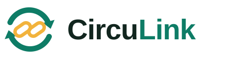

**Keep it in the loop.** CircuLink is a drop-off hub system that keeps items in use and out of the landfill. Residents bring things they no longer need to a hub at a school or barangay. Hub staff weigh each item and sort it: **reuse, repair, recycle or reject**. Reusable items go to verified partner organizations (shelters, schools, NGOs), and recyclables go to recyclers. Everything is weighed, so the main measure is **kilograms kept in use**.

Built for **SDG 12: Responsible Consumption and Production** ("do more and better with less"). It covers targets 12.2 (efficient use of resources), 12.3 (food waste), 12.4 (hazardous waste), 12.5 (reduce, reuse, recycle), 12.6 (reporting) and 12.8 (awareness). The full design is in [`docs/CIRCULAR_HUB_SPEC.md`](docs/CIRCULAR_HUB_SPEC.md).

The app and portal work in **English and Filipino**.

## Fair by design

Points can't be gamed:

- **Only hub staff create points**, and only after physically weighing real items. Residents never confirm anything that earns points.
- **Only approved partner organizations receive items.** Residents can't receive items, so nobody can give to themselves or to a second account.
- **One account per email, per phone number and per student ID.**
- Staff can't process their own drop-offs, unusual weights are flagged for an admin, and every change goes into an append-only audit log.
- Points can't be transferred and have no cash value.

The rules are numbered R1 to R13 in the spec, and each one has an automated test.

## What is in this folder

| Folder | What it is |
|---|---|
| `app/` | The **resident mobile app** (Flutter, Android): find hubs, declare items, see your impact. |
| `portal/` | The **web portal** (React) for hub staff, partner organizations and admins. |
| `server/` | The **API** (Node.js + Express) that both use. |
| `database/` | The **MySQL** schema (`schema.sql`), numbered migrations, and local database setup (`create-test-db.sql`). |
| `brand/` | The logo, icons and colors, one source for the app and the portal (`node build-brand.mjs`, `node build-icons.mjs`). |
| `docs/` | `CIRCULAR_HUB_SPEC.md` (what we are building), `SETUP.md` (how to run it), `CONTAINERS.md` (Docker), `ARCHITECTURE.md` (how it fits together), `DESIGN_SYSTEM.md` (how it looks), `RELEASE.md`, `CHANGELOG.md`. |
| `Dockerfile`, `docker-compose*.yml` | MySQL, the API and the portal in containers. |

## Quick start

See **[`docs/SETUP.md`](docs/SETUP.md)** for the step-by-step version. In short:

1. Install Node.js 22+ and MySQL 8, then run `mysql -u root -p -e "source database/create-test-db.sql"` once (it creates the `circulink` account and databases).
2. `mysql -u root -p < database/schema.sql`, then in `server/`: copy `.env.example` to `.env`, fill in the database login, then `npm install`, `npm run migrate`, `npm run seed`, `npm start`.
3. In `portal/`: `npm install`, `npm run build`. Open http://localhost:4000.
4. In `app/`: plug in an Android phone and double-click `run-phone.cmd`, or run `flutter run -d chrome`.
5. Tests: `cd server && npm test`, `cd portal && npm run test:e2e`, `cd app && flutter test`.

## Demo accounts (password for all: `circulink123`)

| Who | Email | Where |
|---|---|---|
| Admin | `admin@circulink.test` | Portal |
| Hub staff (Campus Green Hub, Barangay San Isidro MRF) | `staff@circulink.test`, `staff2@circulink.test` | Portal |
| Partner organization (approved) | `partner@circulink.test` | Portal |
| Partner organization (waiting for approval) | `partner2@circulink.test` | Portal |
| Residents | `ana@`, `ben@`, `carlo@circulink.test` | App |

## Build status

Step 1 of 9 is done: the rebrand, a clean slate, and the new database. The [spec](docs/CIRCULAR_HUB_SPEC.md#10-build-order) lists the remaining steps.
